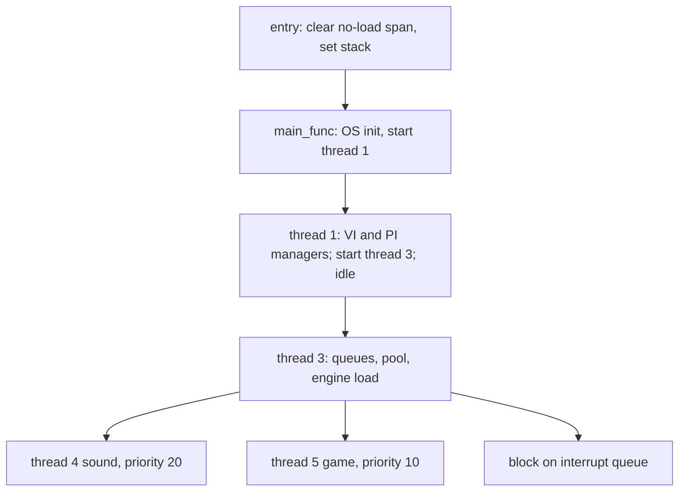

# Mario USA boot, scheduling and event boundaries (#61)

Status: static investigation; #61 remains open because no event sequence or repeatable timing was captured. Parent [#16](https://github.com/BrantTanner/MarioCraft/issues/16); movement consumer [#11](https://github.com/BrantTanner/MarioCraft/issues/11); graphics RSP [#63](https://github.com/BrantTanner/MarioCraft/issues/63) and audio RSP [#64](https://github.com/BrantTanner/MarioCraft/issues/64). This describes source and selected native CPU evidence, not RSP instructions or actual execution timing.

Source is [`n64decomp/sm64` at `9921382a68bb0c865e5e45eb594d9c64db59b1af`](https://github.com/n64decomp/sm64/tree/9921382a68bb0c865e5e45eb594d9c64db59b1af). Links below use that exact revision. Source-to-target matches are bounded behavioral correspondences, not proof of a whole-source rebuild. Target is the 8 MiB USA revision 0 cartridge SHA-256 `17CE077343C6133F8C9F2D6D6D9A4AB62C8CD2AA57C40AEA1F490B4C8BB21D91`. #10's title-screen prefix is 947,552 directly compared bytes up to the first mismatch, not proof of a full memory map or BSS. The pre-entry PIF/IPL3 and initial-load relationship is not traced by the entry block; #62 handles that boundary. A loader-supplied PIF blob is external, not cartridge ROM content. The SI MMIO operations described below are separately observed native instructions, not evidence of that blob.

## Startup and threads

The non-CN [entry code](https://github.com/n64decomp/sm64/blob/9921382a68bb0c865e5e45eb594d9c64db59b1af/asm/entry.s#L29-L45) clears the linker-declared no-load span in eight-byte steps, sets the idle stack, and jumps to `main_func`. Linker extents and loader/BSS details belong to #62. The selected target entry is corroborated at PC `80246000`; Ghidra merges the tail jump with the `main_func` body in its decompilation, so its 56-byte entry envelope must not be treated as the entire recovered function. `main_func` initializes OS, creates thread 1 at priority 100 and starts it. Thread 1 creates the VI manager, chooses NTSC or PAL mode from `osTvType` on US, blacks the screen, configures filtering, creates PI manager with a 32-message buffer, creates thread 3 at priority 100, starts it if `D_8032C650 == 0`, then lowers itself to priority 0 and idles. Thread 3 initializes queues/pool, loads engine code, creates and starts sound thread 4 priority 20 and game thread 5 priority 10, then blocks on the interrupt queue. See [main.c](https://github.com/n64decomp/sm64/blob/9921382a68bb0c865e5e45eb594d9c64db59b1af/src/game/main.c#L113-L135), [thread 3](https://github.com/n64decomp/sm64/blob/9921382a68bb0c865e5e45eb594d9c64db59b1af/src/game/main.c#L332-L366), and [thread 1 and main](https://github.com/n64decomp/sm64/blob/9921382a68bb0c865e5e45eb594d9c64db59b1af/src/game/main.c#L422-L463).



## Finite event and task boundaries

Capacities are source buffer counts, not observed occupancy. Nonblocking send results below are not checked by these callers; do not infer guaranteed delivery under saturation. Message IDs are integer values carried as `OSMesg`.

| Boundary and capacity | Producer  to  consumer | Message and consequence |
|---|---|---|
| interrupt queue, 16 | VI manager  to  thread 3 | VI ID 102 registered with retrace count 1; `handle_vblank` increments count, drains task queue and signals handlers. |
| interrupt queue, 16 | OS SP/DP events  to  thread 3 | SP 100 invokes SP completion; DP 101 invokes DP completion. |
| interrupt queue, 16 | OS PRENMI  to  thread 3 | 104 starts reset processing. |
| interrupt queue, 16 | graphics submitter  to  thread 3 | 103 requests starting graphics when an immediate current slot was available. Disabled audio path also sends synthetic SP-complete 100. |
| SP task queue, 16 | sound dispatch or generic sender  to  thread 3 on VI | Task pointers drained nonblocking. Type 2 replaces next-audio slot, type 1 replaces next-display slot; unknown types have no switch case. Next is promoted only when corresponding current slot is empty. Generic sender has no source call sites in the inspected source. |
| sound queue, 1 | handler 1 on VI  to  thread 4 | 512; sound thread blocks, constructs audio task while reset timer <25 and submits a non-null task. |
| game vblank queue, 1 | handler 2 on VI  to  thread 5 | 1; normal display path consumes twice, with buffer swap between receives. Reset-bars path also consumes twice. |
| graphics completion queue, 1 | thread 3 on DP complete  to  thread 5 | descriptor's message 2; game waits before submitting the next display list. |
| SI event queue, 1 | OS SI event  to  game thread/controller and other SI users | NULL completion; controller flow is documented below. |
| DMA queue 1 and PI manager queue 32 | PI/DMA paths | Initialized at boot; detailed ownership and DMA completion are #62, not a VI signal. |

Sources: [queue setup and scheduler](https://github.com/n64decomp/sm64/blob/9921382a68bb0c865e5e45eb594d9c64db59b1af/src/game/main.c#L113-L405), [game queues and task](https://github.com/n64decomp/sm64/blob/9921382a68bb0c865e5e45eb594d9c64db59b1af/src/game/game_init.c#L39-L42), [graphics descriptor](https://github.com/n64decomp/sm64/blob/9921382a68bb0c865e5e45eb594d9c64db59b1af/src/game/game_init.c#L238-L252), [sound thread](https://github.com/n64decomp/sm64/blob/9921382a68bb0c865e5e45eb594d9c64db59b1af/src/game/sound_init.c#L331-L359). Audio task constructed in [audio/external.c](https://github.com/n64decomp/sm64/blob/9921382a68bb0c865e5e45eb594d9c64db59b1af/src/audio/external.c#L779) has a null completion queue; the scheduler conditionally supports non-null descriptors.

## One normal loop and task arbitration

```mermaid
sequenceDiagram
  participant VI as VI/event machinery
  participant T3 as Thread 3 scheduler
  participant T4 as Thread 4 sound
  participant T5 as Thread 5 game
  participant RCP as SP and DP
  VI->>T3: 102 vblank
  T3->>T4: 512 nonblocking
  T3->>T5: 1 nonblocking
  T4->>T3: enqueue audio task, nonblocking
  Note over T3: On a subsequent vblank, drain task queue and prefer current audio
  T5->>T5: start SI read; tick audio; select pool; consume input; execute level script
  T5->>T5: wait previous graphics DP completion
  T5->>T3: submit display list; request 103 if current slot free
  T3->>RCP: start eligible SP task
  RCP->>T3: SP complete 100; DP complete 101 when applicable
  T3->>T5: graphics descriptor completion 2 at DP complete
  T5->>T5: wait vblank, swap buffer, wait vblank
```

This diagram shows causal paths, not a measured universal ordering between threads or a promise that every message arrives. Depending on prior queue state, VI may drain an earlier task and the relative scheduling of threads varies. `display_and_vsync` uses two blocking game-vblank receives per loop; this source structure is not a measurement of 30 Hz wall-clock or behavior when messages are dropped. Source: [game loop](https://github.com/n64decomp/sm64/blob/9921382a68bb0c865e5e45eb594d9c64db59b1af/src/game/game_init.c#L645-L707), [display path](https://github.com/n64decomp/sm64/blob/9921382a68bb0c865e5e45eb594d9c64db59b1af/src/game/game_init.c#L360-L384).

At VI, current audio takes precedence. If graphics occupies SP, the scheduler marks it interrupted and requests yield; the SP completion handler checks whether it actually yielded. If it completed before yield, it marks the graphics task finished, then starts audio. When audio completes, graphics starts or resumes if not finished. An SP-finished graphics task remains current until DP completion, which sends its optional completion message, marks it DP-finished, and clears the current pointer. If no audio is current, VI can start an eligible graphics task. There is also a separate 103 path which starts an unstarted current graphics task if SP is idle. These are source branches, not measured interrupt latency. See [vblank and completion handlers](https://github.com/n64decomp/sm64/blob/9921382a68bb0c865e5e45eb594d9c64db59b1af/src/game/main.c#L186-L330).

PRENMI sets reset timer 1, clears reset-bar timer, stops continuous sounds, disables selected background SFX banks and fades music over 90 units as passed to the source function. US increments the timer on VI while its signed value is greater than zero. Game loop then draws reset bars instead of normal gameplay, waiting twice for vblank each pass; sound thread skips generation at timer >=25. This documents software handling, not a witnessed reset duration or persistence. The signed timer's long-term behavior and ultimate hardware reset are not established here; persistence is #65.

## Controller poll and handoff

The game thread initializes controller status/pads through `osContInit` and probes EEPROM on the shared SI queue. It scans four port bits in ascending order and maps at most two present ports to application controllers. The initial controller 0 pointers are assigned before that scan, a detail that matters when interpreting no-controller and error paths. At each ordinary game loop, if `gControllerBits` is nonzero, the thread starts an SI read, then after the audio tick and pool selection, `read_controller_inputs` blocks for SI completion and calls `osContGetReadData`. Demo logic can replace the first pad's stick and buttons, preserve a real Start press, and clear player 2; it masks unused first-pad buttons. For each of two application controllers, a non-null pad pointer supplies raw stick and current buttons; `buttonPressed = new & (new ^ old)`, then `buttonDown = new`. A null pointer zeros those fields and analog values. Player 1's resulting fields are copied to player 3. Stick axes inside (-8, 8) become zero; other values shift six units toward zero and the magnitude is clamped to 64. [Controller setup and input](https://github.com/n64decomp/sm64/blob/9921382a68bb0c865e5e45eb594d9c64db59b1af/src/game/game_init.c#L420-L605); [main loop](https://github.com/n64decomp/sm64/blob/9921382a68bb0c865e5e45eb594d9c64db59b1af/src/game/game_init.c#L645-L707); downstream movement is [#11](https://github.com/BrantTanner/MarioCraft/issues/11).

The pinned [OS controller read](https://github.com/n64decomp/sm64/blob/9921382a68bb0c865e5e45eb594d9c64db59b1af/lib/src/osContStartReadData.c) acquires an SI access token; when the last command differs from read, it packs a request, starts a 64-byte write DMA and waits for SI completion, then starts the read DMA, records the command and releases access. The later game receive waits for that read completion. [Raw SI DMA](https://github.com/n64decomp/sm64/blob/9921382a68bb0c865e5e45eb594d9c64db59b1af/lib/src/__osSiRawStartDma.c) checks device busy, writes back cache for a write, sets the physical DRAM address, initiates the appropriate 64-byte transfer against PIF address `1FC007C0`, and invalidates cache on read. The access queue is a one-token lock, not the SI completion queue. [Controller initialization](https://github.com/n64decomp/sm64/blob/9921382a68bb0c865e5e45eb594d9c64db59b1af/lib/src/osContInit.c) waits until the OS clock reaches 500 ms if needed, then performs request write/read transfers for four controllers and creates the access queue. These are static paths and constants, not measured waits.

Error status gates updates inside the OS pad decoder; the application does not automatically zero a non-null pad on an error. This is a static path and does not prove behavior for a physical unplug or a particular emulator. Input sampling, SI completion timing, and observed edge behavior remain unmeasured. Selected native game input entry is `80248638`, initialization `80248824`, game thread `80248AF0`; those addresses are bounded source-correspondence interpretations from native flow, not runtime observations.

## Exact target CPU anchors

Ghidra 12.1.4 read-only/no-analysis inspection identified code envelopes; the target ROM SHA was checked before reading. For every row, independently hashing the ROM range at `PC - 0x80245000` reproduced the Ghidra envelope SHA-256. This subtraction is limited to PC `[80246000,8032D560)` and does not prove other mappings. The entry envelope is only the 56-byte contiguous entry block. Native labels are source-correspondence interpretations from branch/call/data patterns, rather than recovered original symbols.

| Source correspondence | PC | ROM offset | Length | SHA-256 |
|---|---:|---:|---:|---|
| entry | `0x80246000` | `0x1000` | 56 | `0E3F522A33D25B713D0C9E1AD39BE1EBD6C613AA3039EE967DA0239289977BB6` |
| queues | `0x802461fc` | `0x11fc` | 228 | `FAB914B2601DBF64CA9FE093CF20A5E6185CB0E9F645F7449EC811113184D0F9` |
| nmi | `0x8024639c` | `0x139c` | 80 | `D18207D206C0BAAA8570AB71966A6C6146C9B8B4A50665E2030235665755AA26` |
| receive | `0x802463ec` | `0x13ec` | 304 | `F1EDFE78ECA05B6E7527EA4A8E32D9CC0EE99C8600DA66E8259333BA1A5EA189` |
| start | `0x8024651c` | `0x151c` | 128 | `266626D154099588D54CF7C2C21B16F4D486868400189056FD0DF10C09C705FC` |
| vblank | `0x8024669c` | `0x169c` | 352 | `D5384DAFAF1F865DFCE57BEF44B87C8E246EF0F27AE9E73B5518DE3792D48186` |
| sp | `0x802467fc` | `0x17fc` | 336 | `EE7B6D33B81E150751C64FC4A82B6FB146F39F3A16588F961E5B3671EFE3882F` |
| dp | `0x8024694c` | `0x194c` | 108 | `BB581F84AB221A47074046FF9C78FCAD670957F6C32F13DF8BA7DD1A2D53627C` |
| thread3 | `0x802469b8` | `0x19b8` | 324 | `F365F941DD19D539177F668748C177033693208C3E453C03EEE98A139C0BFB34` |
| submit_gfx | `0x80246c10` | `0x1c10` | 140 | `C685D107C50B20B0A8598D6351AB72E9535E5378D7B3B9C2CBDBBE11E91F746E` |
| idle | `0x80246cf0` | `0x1cf0` | 240 | `D2A617CF07E1C7742F6D5E65997406FDFB86F2A9FAED099758E1FF240F53F864` |
| main | `0x80246df8` | `0x1df8` | 112 | `2123B726A37A12C6A3A6EDA1557FE9721D6CB0930B5DFE2AB992A29083E27D6A` |
| display_and_vsync | `0x80248090` | `0x3090` | 336 | `E99EAE5C8E55A9D9EA6C448BCBB5CC3F2F7F8FBB18268FEB21EF03A2761821BF` |
| read_controller_inputs | `0x80248638` | `0x3638` | 492 | `7181A76AD986E0D8B561D08CCAFC131D23E375A24499C1CE9F8CDDD7F34DFCB5` |
| init_controllers | `0x80248824` | `0x3824` | 320 | `12778859D7212A13CDEB90B1E9E6792B18CB7086B2393B8AF8BDB61551BFBB62` |
| thread5_game_loop | `0x80248af0` | `0x3af0` | 304 | `3803A94B6382A0BCA4A800572CA6F9F46D7598B5599114F35B2BA602F4E292C4` |
| OS start read | `0x80323a60` | `0xdea60` | 196 | `0D15AF95E63F2ADBDAAD8044D893FA6DA77FC747A4951CA1215324EC19992EBF` |
| OS decode | `0x80323b24` | `0xdeb24` | 168 | `E44DF93AFA2350ADC39839436674B933E9E59413ED5CC2B5D618890EB79335BF` |
| OS controller init | `0x80323cc0` | `0xdecc0` | 508 | `B865C37C56D195F520CB12E642A1980FBF7B8F1907CB77103E63978ED6A1B633` |
| OS pack read | `0x80323bcc` | `0xdebcc` | 236 | `10895386F7CC0BAAC9FE160B02D6124FB95C6963963F01420FF54E9CE273D865` |
| SI raw DMA | `0x80328960` | `0xe3960` | 172 | `3B46D1251FF5C36D420F16463E627358411395F362CBB6E7F808101AEA2504D4` |
| SI acquire | `0x803288f0` | `0xe38f0` | 68 | `2BAF88D20BEB6416EC82E0A2864731195074E9B89FC601C873360FF24F655B39` |
| SI release | `0x80328934` | `0xe3934` | 44 | `D36DD3C6F6E7780BBC949D832E00B081FE7BFA187365D99FFB6D453C67CCAAC1` |
| SI access queue init | `0x803288a0` | `0xe38a0` | 80 | `0F19493978D42AE24F1E9288FE0196BFBAA5A05CD09DD85D575146648AF204CC` |

The scheduler queue setup native code registers the same five IDs and counts, thread 3 dispatches 100-104, and its native thread-creation calls contain priorities 20 and 10. The native SP and DP branches corroborate the selected source correspondence. Ghidra output and local ROM are private; this table contains only offsets, lengths, hashes and interpretations.

## Open evidence

No new runtime input, interrupt trace, task descriptor capture, frame timing, queue pressure, reset or transition was observed for this issue. Existing title and passive course snapshots represent individual moments and cannot establish event order. Indirect callback `gGoddardVblankCallback` is conditionally called and cleared in the display path; a source assignment supplies `gd_vblank` in `mario_misc.c`; other possible assignments and runtime execution remain unresolved. OS, SI, PI and task-library internals are separate code boundaries; graphics and audio RSP instruction and microcode analyses remain #63 and #64. #61 stays open until representative repeatable timing/event evidence is obtained; continue independent research without altering canonical saves or states.

