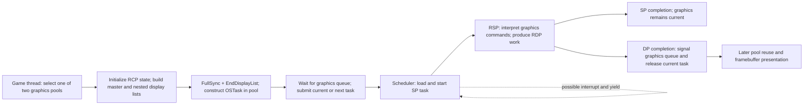

# Mario 64 graphics task and RSP evidence

Status: bounded static research for [#63](https://github.com/BrantTanner/MarioCraft/issues/63); **open**. A runtime task descriptor at a documented moment remains required. No new runtime observation was made. Target: USA revision 0, 8 MiB big-endian image, SHA-256 `17CE077343C6133F8C9F2D6D6D9A4AB62C8CD2AA57C40AEA1F490B4C8BB21D91`. Source is the reconstruction [n64decomp/sm64 at 9921382a68bb0c865e5e45eb594d9c64db59b1af](https://github.com/n64decomp/sm64/tree/9921382a68bb0c865e5e45eb594d9c64db59b1af); source labels and static interpretations are not observed execution. #61 owns scheduling, #58 content loading, #13 presentation.

## Task ownership and flow

This is the ordinary source path, not a measured timing sequence. `render_init` prepares the initial pool/task; `select_gfx_pool` alternates two pools by global timer. The master list initializes segment table, RDP, RSP, Z-buffer and framebuffer; rendering code appends nested lists and geometry. `end_master_display_list` appends RDP FullSync and SP EndDisplayList then creates the task. `display_and_vsync` waits on the graphics queue before submission, swaps the rendered framebuffer after a game-vblank receive, then waits another vblank. Source's first-frame path differs from ordinary frames. [Construction and presentation](https://github.com/n64decomp/sm64/blob/9921382a68bb0c865e5e45eb594d9c64db59b1af/src/game/game_init.c#L245-L380), [graphics pools](https://github.com/n64decomp/sm64/blob/9921382a68bb0c865e5e45eb594d9c64db59b1af/src/buffers/buffers.c#L20-L53), [game loop](https://github.com/n64decomp/sm64/blob/9921382a68bb0c865e5e45eb594d9c64db59b1af/src/game/game_init.c#L645-L707).

The scheduler selects current or next graphics work, calls `osSpTaskLoad` and `osSpTaskStartGo`, and may request yield when higher-priority work needs SP. SP completion marks the graphics task finished but leaves its current pointer in place; DP completion sends the configured message, marks DP-finished and clears that pointer. This accounts for separate SP and DP events, not actual latency or a captured frame. [Scheduler](https://github.com/n64decomp/sm64/blob/9921382a68bb0c865e5e45eb594d9c64db59b1af/src/game/main.c#L160-L330), [submission](https://github.com/n64decomp/sm64/blob/9921382a68bb0c865e5e45eb594d9c64db59b1af/src/game/main.c#L394-L408), [#61](MARIO64-ISSUE61-BOOT-INPUT-SCHEDULING.md).

The 64-byte `OSTask_t` fields are type/flags, boot pointer/length, code pointer/length, data pointer/length, DRAM stack pointer/length, output start/end pointer, display-list pointer/byte count and yield pointer/length. Source sets type 1, flags zero, boot `rspF3DBootStart`, code `rspF3DStart`, data `rspF3DDataStart`, code size `0x1000`, data size `0x800`, stack size `0x400`, yield size `0x900` in the ordinary US configuration. The output size field is set to an end pointer, not a byte count. The list byte count is the difference between head and pool start times `sizeof(Gfx)`. Each pool holds 6,400 `Gfx` entries and a task; stack, yield, output and framebuffers have separate storage. The source comment says code size is ignored; this is a source observation rather than a hardware-wide claim. [Descriptor layout](https://github.com/n64decomp/sm64/blob/9921382a68bb0c865e5e45eb594d9c64db59b1af/include/PR/sptask.h#L70-L100), [constants](https://github.com/n64decomp/sm64/blob/9921382a68bb0c865e5e45eb594d9c64db59b1af/include/PR/ucode.h#L1-L15), [pool structure](https://github.com/n64decomp/sm64/blob/9921382a68bb0c865e5e45eb594d9c64db59b1af/src/game/game_init.h#L12-L17).

For the US configuration, the output array is `0x3E00` 64-bit elements (`0x1F000` bytes). Before selecting current or next task, `exec_display_list` writes back the CPU data cache, marks the task not started and, for a vacant current slot, sends the scheduler a start message. This is the CPU-to-SP visibility and ownership handoff in source; it does not by itself prove when the RDP consumed the output. [Output buffer declaration](https://github.com/n64decomp/sm64/blob/9921382a68bb0c865e5e45eb594d9c64db59b1af/src/buffers/gfx_output_buffer.h#L4-L16), [handoff](https://github.com/n64decomp/sm64/blob/9921382a68bb0c865e5e45eb594d9c64db59b1af/src/game/main.c#L394-L406).

The task library copies the 64-byte descriptor into a temporary structure and converts its seven non-null code, data, stack, output start/end, list and yield pointers to physical addresses; the boot pointer is handled at the DMA boundary. On a resumed task, flag bit 0 substitutes the yield buffer for microcode data and is cleared in the original descriptor. The library writes back the temporary descriptor, sets SP status, waits until the halted SP accepts PC `0x04001000`, transfers the descriptor to DMEM `0x04000FC0`, waits for the device and transfers boot code to IMEM `0x04001000`. Start waits for the device and updates status to run. Yield requests and the yielded-status test are separate operations. These are static source and matched native findings, not measured timing. [Task load/start source](https://github.com/n64decomp/sm64/blob/9921382a68bb0c865e5e45eb594d9c64db59b1af/lib/src/osSpTaskLoadGo.c), [yield](https://github.com/n64decomp/sm64/blob/9921382a68bb0c865e5e45eb594d9c64db59b1af/lib/src/osSpTaskYield.c), [yield result](https://github.com/n64decomp/sm64/blob/9921382a68bb0c865e5e45eb594d9c64db59b1af/lib/src/osSpTaskYielded.c), [raw DMA](https://github.com/n64decomp/sm64/blob/9921382a68bb0c865e5e45eb594d9c64db59b1af/lib/src/__osSpRawStartDma.c).

The following complete native function windows were checked against the verified ROM using the established initial-copy mapping `ROM = PC - 0x80245000`. Source names are correlations, not symbol information stored in the cartridge. Lengths include the full selected function envelope.

| Source correlation | PC | ROM offset | Bytes | SHA-256 |
|---|---:|---:|---:|---|
| `_VirtualToPhysicalTask` | `0x80322940` | `0xDD940` | 284 | `32BEB60161C3FB4C8F24B161B7B2C0B9B6AFE077E101745D22979E9CA6D0C38D` |
| `osSpTaskLoad` | `0x80322A5C` | `0xDDA5C` | 352 | `4923078FCF45566BB483D684BA37DCBC962B5DFB81ACB7D7D6BF4326AFE8C801` |
| `osSpTaskStartGo` | `0x80322BBC` | `0xDDBBC` | 64 | `EB490D2FBAD867D74FE59A9FB99D66148FC8C724194961B5E699FD725AD0F1B6` |
| `osSpTaskYield` | `0x80322C00` | `0xDDC00` | 32 | `4171311CE4014D9D6F53A9E80EA83438CB5FEE8B14C1FFE963526C0186C343C1` |
| `osSpTaskYielded` | `0x80322D70` | `0xDDD70` | 128 | `A3FE2F19FFD11BBFA1BE4416A0EA3412501FDB93C71F8934D6F17D8EE7DBBEF9` |
| `__osSpSetStatus` | `0x80327F30` | `0xE2F30` | 12 | `330EEBE5BB4046809FE403996CD6DD002C11B2A46FC3CBA6AB4A6DD9611E273B` |
| `__osSpSetPc` | `0x80327F40` | `0xE2F40` | 52 | `AF66ED65D77FDE1AAE49EEDB1374B1C64C2305B9DFB37653F1B09D17ADB34BDC` |
| `__osSpRawStartDma` | `0x80327F80` | `0xE2F80` | 140 | `C0E868E07EE14D11F63677FCFCC9BBBB32B4C29A326AD19C8FC3119ADB355A88` |
| `__osSpDeviceBusy` | `0x80328010` | `0xE3010` | 44 | `5B8A49766E2E41E50B893CB38C81DB6EBAAACF069CEFE96035B118B0D9F9C4F0` |
| `__osSpGetStatus` | `0x80328040` | `0xE3040` | 12 | `CDFFEF6FD78FBD686568FEE0ACD532CCB940758F852CB83E15E44ABA19A741ED` |

## Protocol and finite variants

Nintendo's [graphics task tutorial](https://ultra64.ca/files/documentation/online-manuals/man-v5-1/tutorial/basic/3/3_2.htm) describes `Gfx` as a 64-bit command list interpreted by graphics microcode. In this source, operations include vertex loading, nested display-list calls, end-of-list, geometry mode, and RDP commands; the CPU builds command data, while RSP interpretation and RDP rendering are distinct stages. The [Fast3D source dispatch tables and implementation](https://github.com/n64decomp/sm64/blob/9921382a68bb0c865e5e45eb594d9c64db59b1af/rsp/fast3d.s#L110-L150) identify the source's command handling, not proof of an observed command stream.

The [pinned build configuration](https://github.com/n64decomp/sm64/blob/9921382a68bb0c865e5e45eb594d9c64db59b1af/Makefile#L30-L92) declares five selectable graphics families: `f3d_old`, `f3d_new`, `f3dex`, `f3dex2`, and experimental `f3dzex`. JP/US default to old; EU/Shindou/iQue default to new. [Linked source](https://github.com/n64decomp/sm64/blob/9921382a68bb0c865e5e45eb594d9c64db59b1af/lib/rsp.s#L1-L27) selects regular Fast3D or conditional alternate binaries; additional variants are conditional declarations, not evidence of their inclusion in the USA cartridge.

The selected USA code candidate independently decodes at IMEM `0x0400130C` as the old-branch culling sequence: the instruction at `0x04001310` uses immediate `0xFFFF`, matching the source's `F3D_OLD` branch rather than its `0x7070` alternative. The following stack offset also corresponds to old source. Together with the US default and candidate connection below, this is positive bounded classification as old Fast3D; it is not a full assembled-byte comparison or a proof that no unrelated microcode exists elsewhere in the ROM. [Discriminating source branch](https://github.com/n64decomp/sm64/blob/9921382a68bb0c865e5e45eb594d9c64db59b1af/rsp/fast3d.s#L555-L578).

## Exact target candidates and independent RSP decoding

[#48's native descriptor analysis](MARIO64-ISSUE48-MODEL-SKELETON-ANIMATION-RENDERING.md) identified the following candidate blocks by full-range matching. They are static cartridge candidates, not a captured task. Hashes were independently recomputed from the specified ROM; half-open ranges are file offsets. The data range lies outside #62's proven initial-copy mapping; no generic ROM-to-RAM offset is assumed.

| Candidate | ROM span | Length | SHA-256 |
|---|---:|---:|---|
| boot | `[0xE6260,0xE6330)` | 208 | `589D793EDA195C576C9D767E7A5E4B77352826F59669D20BDCC358A8EBC979A3` |
| graphics code | `[0xE6330,0xE7330)` | 4096 | `FFD76B7092CE0C1B6DC2B1FB9992AB2B330F0D813577F49B3A1F32B2AF9AC618` |
| graphics data | `[0xF4AC0,0xF52C0)` | 2048 | `B842FB99D1899C2F0345FCD43BD9F61F38675C39E4EC7BAB5CB130518FBF0F3A` |
| resident decode window | `[0xE6330,0xE6A18)` | 1768 | `F1673394F9C7AB780B40B94BE338C96BFED9505F43D72DAB95A65F934E0A7A43` |

Independent [spimdisasm `rspDisasm`](https://github.com/Decompollaborate/spimdisasm) 1.42.4, with rabbitizer 1.16.2, decoded the resident window as big-endian instructions at source-declared IMEM origin `0x04001080`. Its scalar decode at `0x0400113C` polls SP DMA full and writes SP memory, DRAM and read/write length registers; the source identifies it as a DMA helper. At `0x04001488` it decodes `VMUDH`, followed by vector loads and `VMADL`, `VMADM`, `VMADN`, `VMADH`; source identifies a matrix multiplication sequence. Around `0x040015A8` it decodes vector multiply/accumulate operations corresponding to the source's vertex transformation, using matrix integer and fractional components. This is bounded instruction identification and source correlation, not execution or a complete proof of vector arithmetic state. The [SGI RSP Programmer's Guide v1.1](https://bukosek.si/hardware/collection/sgi-o2/n64-rsp-programmers-guide.pdf) describes 4 KiB IMEM and DMEM, 32 scalar registers and 32 128-bit vector registers; scalar and vector interpretation here uses its instruction architecture. The [source](https://github.com/n64decomp/sm64/blob/9921382a68bb0c865e5e45eb594d9c64db59b1af/rsp/fast3d.s#L332-L415) establishes resident origin and DMA helper; [matrix and vertex operations](https://github.com/n64decomp/sm64/blob/9921382a68bb0c865e5e45eb594d9c64db59b1af/rsp/fast3d.s#L690-L800).

Reproduction: install the named versions in an isolated environment, invoke `python -m spimdisasm.rspDisasm <local-rom> <private-output> --start 0xE6330 --end 0xE6A18 --vram 0x04001080 --endian big`, and compare instruction addresses and mnemonics with the pinned source. Keep raw disassembly and ROM-derived bytes private. The remaining code contains overlays with differing IMEM origins; linear decoding all 4096 bytes at one address would mislabel them. The source declares overlay reloads and distinct origins, so analyze each using its own mapping before claiming full instruction coverage. [Overlay declarations](https://github.com/n64decomp/sm64/blob/9921382a68bb0c865e5e45eb594d9c64db59b1af/rsp/fast3d.s#L1400-L1465).

For one instruction-level interpretation, the guide's `VMUDH` specification describes lane-wise signed 16-bit products shifted into the accumulator, with a signed-clamped result written to the destination; the element selector can broadcast selected operand elements. Its multiply/accumulate family supports combining partial products for higher precision. That explains the role of the decoded sequence without assuming the input register values or proving a rendered result. See the [SGI guide](https://bukosek.si/hardware/collection/sgi-o2/n64-rsp-programmers-guide.pdf), PDF pages 61–63 and 275–276.

## Remaining evidence

Capture and verify an actual task descriptor at a documented moment, including pointers, lengths, selected buffers and code/data provenance, with emulator state distinguished from cartridge candidates. Confirm relevant overlay mappings and instruction behavior before asserting complete microcode coverage. No new capture, timing, or frame execution is claimed. The prior failed helper has no retained stdout/stderr, so its cause remains unknown. Keep #63 and #16 open; no implementation or prototype follows from this research alone.

