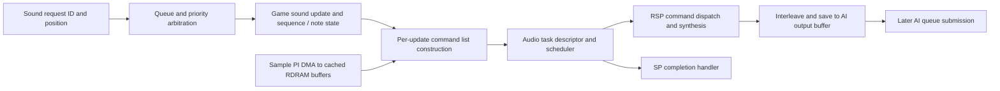

# Mario 64 audio task and RSP evidence

Status: static work for [#64](https://github.com/BrantTanner/MarioCraft/issues/64), **open**. Target USA rev 0, 8 MiB big-endian, SHA-256 `17CE077343C6133F8C9F2D6D6D9A4AB62C8CD2AA57C40AEA1F490B4C8BB21D91`; source reconstruction [n64decomp/sm64, pin 9921382a68bb0c865e5e45eb594d9c64db59b1af](https://github.com/n64decomp/sm64/tree/9921382a68bb0c865e5e45eb594d9c64db59b1af). Static source, exact native and prior observations are distinct; no new runtime descriptor or sound output was captured. [#50](MARIO64-ISSUE50-AUDIO-SEQUENCING.md) and [#13](https://github.com/BrantTanner/MarioCraft/issues/13) own request and presentation evidence; [#61](https://github.com/BrantTanner/MarioCraft/issues/61) owns arbitration.

## Request to output

For a bounded example, #50 identifies native `play_sound` request submission at `0x8031EB00` and consumer `0x8031EB30`, including the ring and priority arbitration; an observed request is not proof that a voice was accepted or heard. The sound thread waits for its vblank message, creates the next audio task, and dispatches a non-null result. USA `create_next_audio_frame_task` skips while loading, toggles two task/command slots, rotates three AI buffers, updates game sound if signaled, and calls synthesis. It queues the buffer indexed two frames behind when its length is nonzero. Source describes that lifecycle as expecting RSP completion; no captured event proves completion before a particular AI submission. [Sound thread](https://github.com/n64decomp/sm64/blob/9921382a68bb0c865e5e45eb594d9c64db59b1af/src/game/sound_init.c#L336-L360), [frame task](https://github.com/n64decomp/sm64/blob/9921382a68bb0c865e5e45eb594d9c64db59b1af/src/audio/external.c#L708-L809).

USA synthesis begins with a segment command, splits the requested sample count into updates, processes sequences and optional reverb per update, and emits note decoding, resampling and mixing commands. A final set-buffer/interleave/save sequence writes stereo output to the selected AI buffer. These are source-declared operations, not a captured command stream. [Synthesis](https://github.com/n64decomp/sm64/blob/9921382a68bb0c865e5e45eb594d9c64db59b1af/src/audio/synthesis.c#L322-L356), [note and output](https://github.com/n64decomp/sm64/blob/9921382a68bb0c865e5e45eb594d9c64db59b1af/src/audio/synthesis.c#L760-L910), [output interleave](https://github.com/n64decomp/sm64/blob/9921382a68bb0c865e5e45eb594d9c64db59b1af/src/audio/synthesis.c#L1077-L1085).

Sample requests reuse a covering buffer if possible; otherwise source aligns cartridge address down to 16 bytes, invalidates the destination cache for USA, starts PI read into an allocated buffer, and returns the adjusted RAM pointer. Two reuse queues have different TTL paths (2 and 60); TTLs decrement at task creation. The source itself questions why this function does not drain the frame DMA queue. Do not infer that a particular sample transfer completed before RSP use from static code alone. [Sample DMA](https://github.com/n64decomp/sm64/blob/9921382a68bb0c865e5e45eb594d9c64db59b1af/src/audio/load.c#L165-L315); #50 records bounded ADPCM framing and source tables without an asset catalog.

The descriptor has type 2, flags 0, boot code and audio text/data pointers, declared code size `0x800` (source comments it is ignored), zero stack and output fields, command-list pointer and byte size `writtenCmds * 8`, and zero yield pointer/size for USA. The wrapper's message queue and message are null. Scheduler source prioritizes audio at vblank and may request a graphics yield; on SP completion it marks audio finished, clears the current audio task and sends a message only if configured. A disabled-audio path can synthesize a completion message, so a completion message alone is not evidence of audio execution. [Descriptor](https://github.com/n64decomp/sm64/blob/9921382a68bb0c865e5e45eb594d9c64db59b1af/src/audio/external.c#L778-L809), [scheduler](https://github.com/n64decomp/sm64/blob/9921382a68bb0c865e5e45eb594d9c64db59b1af/src/game/main.c#L160-L315), [task fields](https://github.com/n64decomp/sm64/blob/9921382a68bb0c865e5e45eb594d9c64db59b1af/include/PR/sptask.h#L70-L100).

AI length returns the AI length register; the frame constructor divides by four to count stereo sample frames. `osAiSetNextBuffer` adjusts the submitted address by `0x2000` when the prior boundary flag is set, calculates the next flag from `((original address + length) & 0x3FFF) == 0x2000` before testing busy, then returns `-1` if the AI status full bit is set; otherwise it writes the physical address and length. The constructor ignores that return, so a call does not establish queue acceptance. Frequency setup computes a rounded DAC divisor, rejects values below 132, clamps the derived bitrate to 16, writes DAC, bitrate and control registers and returns the resulting clock/divisor frequency. No actual frequency or register transition was measured. [AI buffer](https://github.com/n64decomp/sm64/blob/9921382a68bb0c865e5e45eb594d9c64db59b1af/lib/src/osAiSetNextBuffer.c), [length](https://github.com/n64decomp/sm64/blob/9921382a68bb0c865e5e45eb594d9c64db59b1af/lib/src/osAiGetLength.c), [frequency](https://github.com/n64decomp/sm64/blob/9921382a68bb0c865e5e45eb594d9c64db59b1af/lib/src/osAiSetFrequency.c).

Seven complete native function envelopes were verified against ROM with the established initial-copy mapping `ROM = PC - 0x80245000`. Names correlate with source; hashes cover full selected envelopes, including any body gaps.

| Source correlation | PC | ROM offset | Bytes | SHA-256 |
|---|---:|---:|---:|---|
| `create_next_audio_frame_task` | `0x8031e7b8` | `0xd97b8` | 840 | `A3FE6B22CCEC01EDBAC9EF31370950D5B0FABAEE7857606486037319348D8076` |
| `osAiGetLength` | `0x80325da0` | `0xe0da0` | 12 | `7CEFBA84F102A6E268DF8818DECAFBA648AC8C164C1CA2B9FEBF799B5A559671` |
| `osAiSetNextBuffer` | `0x80325db0` | `0xe0db0` | 168 | `AD04E8D41678B74459309FAFBEA39F0474E53667632CE0C678D477A7E159A9CB` |
| `audio_init` | `0x8031950c` | `0xd450c` | 1032 | `7E73675AEEB84482BCFA5C8580040849858A252A574C27B19BA653E60D1BE441` |
| `synthesis_execute` | `0x80314de4` | `0xcfde4` | 384 | `1F7E094E8900E2D7CFF9A29AEE4E3DACA193EFCEB8D39DB4153A93981E3941F6` |
| `osAiSetFrequency` | `0x80325970` | `0xe0970` | 352 | `4B7A57289A96E57469ADA9080FD7802D998A11874867EC642E35560D27907E84` |
| `__osAiDeviceBusy` | `0x80329750` | `0xe4750` | 48 | `94D8674F022E85B272C7575B4A263FD32588717BB737E3A99536D3C589DB394F` |

## Source variants and target matches

`rsp/audio.s` declares a common JP/US/EU branch and a distinct SH/CN branch; ABI command numbers differ, including load/save and envelope operations. JP descriptor additionally allocates a yield buffer while USA does not. These are source configuration distinctions, not claims about every regional cartridge. [Program](https://github.com/n64decomp/sm64/blob/9921382a68bb0c865e5e45eb594d9c64db59b1af/rsp/audio.s#L1-L100), [ABI](https://github.com/n64decomp/sm64/blob/9921382a68bb0c865e5e45eb594d9c64db59b1af/include/PR/abi.h#L33-L76), [descriptor condition](https://github.com/n64decomp/sm64/blob/9921382a68bb0c865e5e45eb594d9c64db59b1af/src/audio/external.c#L796-L806).

The pinned project's armips 0.11 source was built locally and assembled `audio.s` separately with each single `VERSION_JP`, `VERSION_US`, `VERSION_EU`, `VERSION_SH`, and `VERSION_CN` definition. Exact full-window searches of the verified USA ROM found one match apiece for the JP/US/EU identical outputs; the SH/CN identical outputs had zero whole-window matches. This finite search excludes those exact assembled alternatives only, not every possible altered variant. Native USA descriptor construction independently supplies code pointer `0x8032C740` and data pointer `0x8033A2C0`, size `0x2C0`. Code maps using the established initial-copy interval; data is outside it and is associated by its unique complete match, not an assumed general mapping. Neither association is a captured descriptor.

| Assembled family / window | ROM half-open span | Bytes | SHA-256 |
|---|---:|---:|---|
| JP/US/EU code | `[0xE7740,0xE8560)` | `0xE20` | `14E3B245E8CD4E0BDF4CBB864AF82D1CCBA6D3D3FF33F73CB52C5821A76F30FC` |
| JP/US/EU data | `[0xF52C0,0xF5580)` | `0x2C0` | `79BB2A3E8555019BC4B229F0C218F1E329CA5711BFA55C7C7F992FACF2E12C83` |
| SH/CN code, no exact match | — | `0xF04` | `3FB8D487ADD85135EB0B779A6C199121CD3E615D9E27393EAAB2485CA12485E9` |
| SH/CN data, no exact match | — | `0x330` | `FE71E15E5688314458F3AA760B44F1FFFA4B9D0B04F3E1B1514618283C70EEB2` |

USA is therefore classified as the source's common JP/US/EU audio program by complete text and data matches plus native pointer construction; this does not claim runtime selection or prove alternate programs are absent in transformed form. The native code-size field is `0x800`, distinct from the matched `0xE20` assembled text length; do not interpret the field as the complete program length.

## RSP instructions and commands

The source declares audio code origin `0x04001080` independently; [spimdisasm rspDisasm](https://github.com/Decompollaborate/spimdisasm) 1.42.4 / rabbitizer 1.16.2 independently decoded the exact matched text, big-endian, at that origin. At `0x040010E4`, scalar loads read two command words; shifts and masking select the halfword dispatch entry and indirect jump. The list advances by eight bytes; the helper at `0x04001150` caps each US-family DMA chunk at `0x140` bytes, then the code polls SP DMA and programs its memory, DRAM, and length registers. On exhaustion the program writes SP status and breaks. Source command handlers implement clear, load/save, ADPCM, resample, mixer and interleave among others; CPU command values and DMEM addresses are not raw RSP instructions. [Dispatcher and DMA](https://github.com/n64decomp/sm64/blob/9921382a68bb0c865e5e45eb594d9c64db59b1af/rsp/audio.s#L190-L309), [handlers](https://github.com/n64decomp/sm64/blob/9921382a68bb0c865e5e45eb594d9c64db59b1af/rsp/audio.s#L311-L425).

At `0x04001C48` and `0x04001C54` the independent decoder identifies `VMULF` and `VMACF` in the source envelope-mixer handler; vector loads/stores and repeated multiply/accumulate operations implement a bounded mixing path. The [SGI RSP Programmer's Guide v1.1](https://bukosek.si/hardware/collection/sgi-o2/n64-rsp-programmers-guide.pdf) describes vector registers, accumulator and fractional multiply/accumulate instructions; the static decode supplies neither register values nor audio samples. [Envelope handler](https://github.com/n64decomp/sm64/blob/9921382a68bb0c865e5e45eb594d9c64db59b1af/rsp/audio.s#L1184-L1380).

Reproduce privately: compile the pinned `tools/armips.cpp` and assemble `rsp/audio.s` with the stated version definitions, searching each complete output against the verified local ROM. Decode only the `0xE20` code window with `python -m spimdisasm.rspDisasm <local-rom> <private-output> --start 0xE7740 --end 0xE8560 --vram 0x04001080 --endian big`. Do not publish assembled or ROM-derived bytes or disassembly.

## Remaining evidence

Capture an actual audio task at a documented moment, its descriptor and command/output/sample-buffer provenance, sample-DMA completion and SP/AI transitions, and distinguish request, voice selection and audible output. Runtime observation was deferred; the earlier helper's cause is unknown because stdout/stderr were not retained. Keep #64 and #16 open. No gameplay implementation or prototype follows from these findings.

